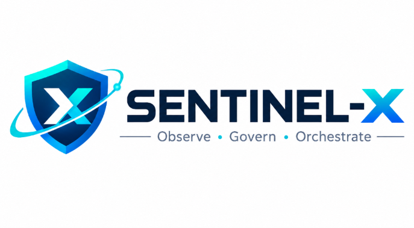
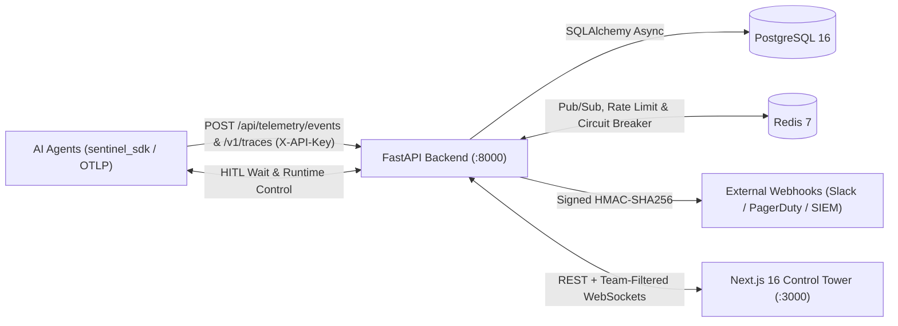

<p align="center">
  
</p>

# SENTINEL-X

**Framework-neutral observability, lineage tracing, and runtime-governance control tower for multi-agent AI systems.**

SENTINEL-X ingests structured spans from Python agent SDKs, zero-touch OpenAI/LangChain wrappers, and OpenTelemetry OTLP/HTTP exporters, builds interactive execution lineage DAGs in real time, evaluates deterministic causal anomalies, enforces synchronous Human-in-the-Loop (HITL) and budget gates before dangerous actions execute, and isolates telemetry across multi-tenant organizational teams.

---

## Key Features

### 1. Framework-Neutral Telemetry & Zero-Touch Instrumentation
- **Canonical Event v1.0 & OTLP/HTTP Ingestion:** Accepts native batches on `POST /api/telemetry/events` and OpenTelemetry `application/json` / `application/x-protobuf` traces on `POST /v1/traces`.
- **Two-Line Auto-Instrumentation:** Calling `sentinel_sdk.instrument(...)` monkey-patches sync and async OpenAI clients (supporting OpenAI, Groq, Google Gemini, Ollama, Hugging Face) and attaches LangChain tool callbacks with zero `@trace_*` decorators.
- **Explicit Decorators & Context Propagation:** Use `@trace_agent`, `@trace_llm`, `@trace_tool`, `start_run(...)`, and `SentinelLangChainCallback` when fine-grained span control is needed.
- **Built-in PII & Secret Redaction:** Recursively masks sensitive fields (`token`, `secret`, `password`, `api_key`, `authorization`, credentials/PII patterns) in `sentinel_sdk` before telemetry leaves the agent process.

### 2. Real-Time Execution Lineage, Replay & Cost Attribution
- **Interactive Agent Lineage DAG:** Renders parent-child and cross-agent spans using React Flow (`@xyflow/react`) and Dagre (`@dagrejs/dagre`), alongside a Latency Waterfall and Span Inspector.
- **Chronological Execution Replay:** Scrub step-by-step through a run's execution timeline in `/runs/[runId]`.
- **Live WebSocket Streaming:** Redis Pub/Sub streams incremental `FLEET_UPDATED`, `RUN_UPDATED`, `SPAN_UPSERT`, `ALERT_CREATED`, `APPROVAL_REQUIRED`, and `APPROVAL_DECIDED` events to authenticated UI sessions.
- **Versioned Cost Attribution (`/costs`):** Computes token and USD spend from effective pricing versions without double-counting nested agent spans (`EXACT`, `ESTIMATED`, and `UNKNOWN` cost basis).

### 3. Deterministic Causal Anomaly Engine
Evaluates every ingested batch and a background watchdog loop to detect:
- **`LOOP_DETECTED`:** Repeated identical tool invocations within a sliding window.
- **`BUDGET_EXCEEDED`:** Run token or USD cost limit breaches.
- **`CASCADE_FAILURE`:** Upstream root-cause tracing (`is_root_cause`) linking downstream impacted spans to the earliest failing tool or parent span.
- **`RUN_STALLED`:** Background stall watchdog transitioning silent in-flight runs (`RUN_STALL_TIMEOUT_SEC`) to `STALLED`.

### 4. Runtime Governance, HITL Gates & Policies
- **Synchronous HITL Pre-Execution Gate (`@gate_tool`):** Suspends high-risk tool execution in `AWAITING_APPROVAL`, emits alerts to `/approvals`, and wakes the suspended agent process via Redis Pub/Sub upon operator/approver decision.
- **Operator Kill-Switch & Budget Circuit-Breaker:** Immediately cancels active runs (`POST /api/runs/{run_id}/cancel`) or trips `run:{run_id}:blocked` when `auto_block_on_budget` is enabled, halting subsequent LLM/tool calls with `RunCancelledError` or `BudgetCircuitBreakerError`.
- **Hierarchical Governance Policies (`/policies`):** Configure org-wide, team-scoped, or agent-scoped token limits, USD spend caps, loop thresholds, and circuit breakers.

### 5. Multi-Tenant Security, Webhooks & Operational Hardening
- **RBAC & Team Isolation:** Enforces `viewer`, `operator`, `approver`, and `admin` permissions with strict team scoping across REST endpoints and WebSocket streams, separating production teams from `demo-sandbox`.
- **Team-Bound Ingestion Keys (`/settings/api-keys`):** Admins can mint and soft-revoke `sk_live_...` API keys stored as SHA-256 digests; the server stamps every ingested event with the key's bound team.
- **Tamper-Evident Audit Log:** Records governance, policy, user, API key, and webhook mutations in an append-only SHA-256 hash-chained `audit_events` table.
- **Outbound Incident Webhooks (`/settings/webhooks`):** Delivers signed (`X-Sentinel-Signature: t=<ts>,v1=<hmac_sha256>`) JSON notifications with exponential backoff retries on `APPROVAL_REQUIRED`, `CASCADE_FAILURE`, `LOOP_DETECTED`, `BUDGET_EXCEEDED`, and `RUN_STALLED`.
- **Rate Limiting & Retention:** Enforces atomic Redis Lua sliding-window ingestion limits (`INGEST_RATE_LIMIT_PER_MIN`) per team and purges expired telemetry older than `RETENTION_DAYS` while preserving immutable `audit_events`.

---

## Architecture



## Repository Structure

```text
sentinalX/
├── .github/workflows/ci.yml   # GitHub Actions CI (Postgres/Redis services, Ruff, Alembic, Pytest, Next.js build)
├── .env.example               # Baseline environment configuration template
├── Makefile                   # Developer shortcuts for Docker, migrations, servers, tests, and demos
├── docker-compose.yml         # Full-stack multi-container orchestration (postgres, redis, backend, frontend)
├── frontend/                  # Next.js 16 + React 19 + TypeScript Control Tower UI (see frontend/README.md)
└── pybackend/                 # Python 3.12 uv workspace: sentinel-sdk, sentinel-backend, sentinel-demo (see pybackend/README.md)
```

For detailed module documentation, see:
- [Frontend README](frontend/README.md)
- [Python Backend & SDK README](pybackend/README.md)

---

## Tech Stack

- **Backend & SDK:** Python 3.12 (`uv` workspace), FastAPI, SQLAlchemy 2.0 (`asyncpg`), Alembic, PostgreSQL 16, Redis 7, Pydantic v2, Argon2 + JWT, `httpx`, `wrapt`, OpenTelemetry Proto.
- **Frontend:** Next.js 16 (App Router, Turbopack), React 19, TypeScript (`strict: true`), Tailwind CSS v4, `@xyflow/react`, `@dagrejs/dagre`, `lucide-react`, `date-fns`.
- **Infrastructure & CI:** Docker multi-stage non-root images, Docker Compose healthchecks, GitHub Actions.

---

## Quick Start

### 1. Configure Environment Variables

Copy `.env.example` to `.env` in the repository root and adjust values if needed:

```bash
cp .env.example .env
```

Key settings in `.env`:
- `DATABASE_URL`, `REDIS_URL`
- `SENTINEL_API_KEY` (default ingestion key for local dev / demo sandbox)
- `JWT_SECRET`, `ENABLE_DEMO_SANDBOX=true`, `ALLOW_DEV_HEADERS=true`
- `INITIAL_ADMIN_EMAIL` / `INITIAL_ADMIN_PASSWORD` (optional bootstrap org admin on first boot)
- `LOOP_THRESHOLD_COUNT`, `LOOP_WINDOW_SECONDS`, `RUN_TOKEN_BUDGET`, `RUN_STALL_TIMEOUT_SEC`
- `INGEST_RATE_LIMIT_PER_MIN=600`, `RETENTION_DAYS=30`
- `NEXT_PUBLIC_API_URL`, `NEXT_PUBLIC_WS_URL`
- Optional live LLM config: `SENTINEL_LIVE_LLM`, `LLM_PROVIDER`, `LLM_BASE_URL`, `LLM_API_KEY`, `LLM_MODEL`

### 2. Run with Docker Compose (Recommended)

```bash
make docker-up
# or: docker compose up --build
```

Services started:
- **PostgreSQL 16:** `localhost:5432`
- **Redis 7:** `localhost:6379`
- **FastAPI Backend:** `http://localhost:8000` (auto-runs `alembic upgrade head` on startup; healthcheck at `/health`)
- **Next.js Control Tower:** `http://localhost:3000`

### 3. Run Locally for Active Development

Start Postgres and Redis, run migrations, and launch backend & frontend dev servers in separate terminals:

```bash
# Terminal 1: Start Postgres & Redis
make infra-up

# Install Python dependencies & apply database migrations
cd pybackend && uv sync --all-packages --dev && cd ..
make migrate

# Terminal 2: Start FastAPI backend (:8000)
make backend-dev

# Terminal 3: Start Next.js frontend (:3000)
cd frontend && npm install && cd ..
make frontend-dev
```

---

## How to Use SENTINEL-X

### 1. Sign In to the Control Tower
Open `http://localhost:3000`.
- **Demo Sandbox Mode (`ENABLE_DEMO_SANDBOX=true`):** Seeded demo accounts (password `sentinel123`) are scoped to `demo-sandbox`:
  - `admin@sentinel.local` (`admin`)
  - `approver@sentinel.local` (`approver`)
  - `operator@sentinel.local` (`operator`)
  - `viewer@sentinel.local` (`viewer`)
- **Organizational Mode:** Configure `INITIAL_ADMIN_EMAIL` and `INITIAL_ADMIN_PASSWORD` in `.env` (or register the initial admin from `/login` when bootstrap is needed), then manage organizational teams/users under `/settings/users`.

### 2. Mint a Team-Bound API Key
As a non-demo organization Admin:
1. Navigate to **`/settings/api-keys`** in the sidebar.
2. Click **Mint Team API Key**, enter a cluster/service name, and select a target team (e.g., `fraud-detection`).
3. Copy the one-time `sk_live_...` secret (stored server-side as a SHA-256 hash). All telemetry sent with this key is automatically stamped with that team.

### 3. Instrument an Agent

**Option A — Zero-Touch OpenAI Auto-Instrumentation (2 lines):**

```python
import openai
import sentinel_sdk

sentinel_sdk.instrument(
    api_key="sk_live_...",
    base_url="http://localhost:8000",
    agent_id="fraud-scoring-service",
)

client = openai.OpenAI()
response = client.chat.completions.create(
    model="gpt-4o-mini",
    messages=[{"role": "user", "content": "Score transaction tx_1042"}],
)
```

**Option B — Explicit Decorators & HITL Gate:**

```python
from sentinel_sdk import gate_tool, start_run, trace_agent, trace_tool

@gate_tool(risk_level="HIGH", reason="Executes external wire transfer")
def execute_wire_transfer(account_id: str, amount: float) -> dict:
    return {"status": "sent", "account_id": account_id, "amount": amount}

@trace_agent(agent_id="payments-orchestrator")
def handle_payment(account_id: str, amount: float) -> dict:
    return execute_wire_transfer(account_id=account_id, amount=amount)

with start_run(agent_id="payments-orchestrator"):
    handle_payment("acct_991", 25000.0)
```

**Option C — Standard OpenTelemetry OTLP/HTTP:**
Point any OpenTelemetry SDK `OTLPSpanExporter` to `http://localhost:8000/v1/traces` with header `X-API-Key: sk_live_...`.

### 4. Run Built-In Demo Scenarios

```bash
make demo-normal     # Multi-agent delegation tree
make demo-hitl       # Synchronous Human-in-the-Loop approval gate (approve/reject in /approvals)
make demo-loop       # Repeated tool loop detection
make demo-slow_loop  # Slow loop + live operator kill-switch cancellation
make demo-budget     # Token/cost budget overrun & circuit breaker
make demo-cascade    # Root-cause cascading failure tracing
make demo-stall      # Run stall watchdog detection
```

Run the standalone zero-touch OpenAI example (offline mock by default, or set `SENTINEL_LIVE_LLM=true`):

```bash
cd pybackend
SENTINEL_API_KEY="sk_live_YOUR_TEAM_KEY" uv run --package sentinel-demo python -m sentinel_demo.zero_touch_example
```

### 5. Configure Governance & Webhooks
- **`/policies`:** Create token limits, cost caps, loop thresholds, and `auto_block_on_budget` rules per org, team, or agent.
- **`/approvals`:** Review pending tool executions triggered by `@gate_tool` and inspect the tamper-evident audit trail.
- **`/costs`:** Track fleet spend and manage versioned model input/output pricing rates.
- **`/settings/webhooks`:** Register endpoints for `APPROVAL_REQUIRED`, `CASCADE_FAILURE`, `LOOP_DETECTED`, `BUDGET_EXCEEDED`, and `RUN_STALLED`, verify `X-Sentinel-Signature`, and trigger `Send Test Ping`.

---

## Testing & Verification

```bash
# Backend lint + full test suite (requires Postgres & Redis running)
cd pybackend
uv run ruff check .
uv run pytest -v

# 10-scenario deterministic evaluation suite
make eval

# Frontend type check, lint, and production build
cd frontend
npx tsc --noEmit && npm run lint && npm run build
```

